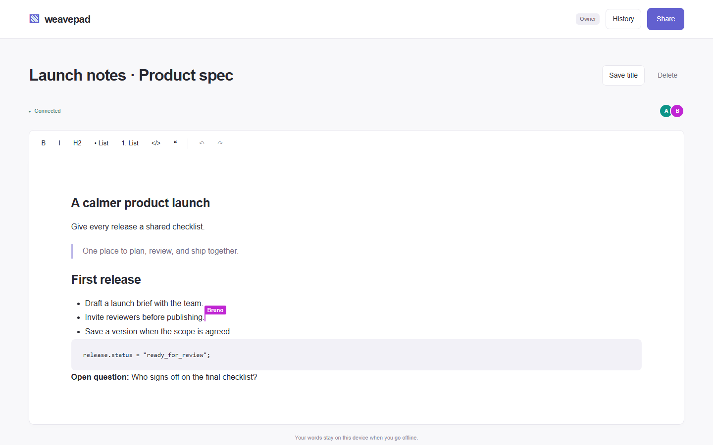
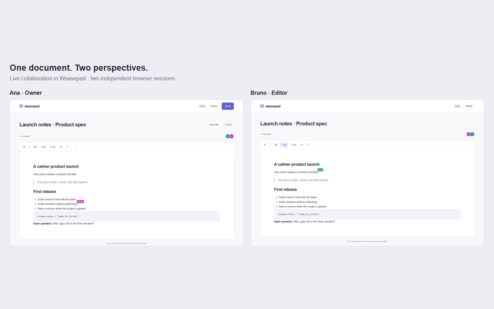
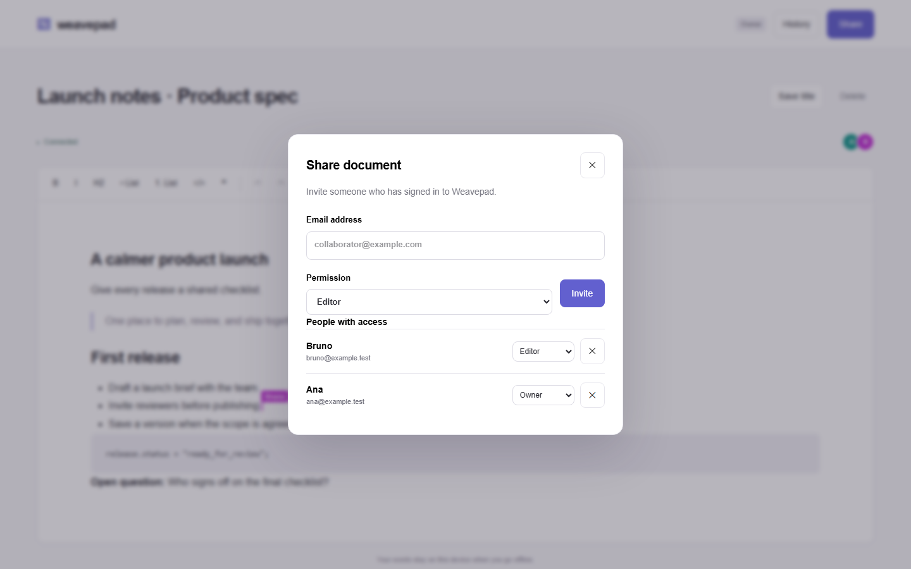
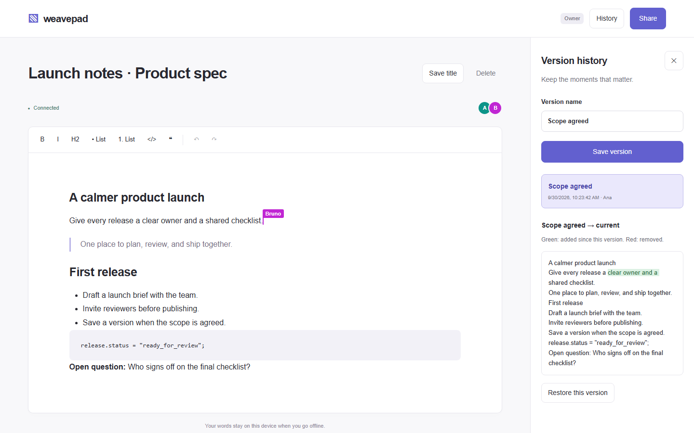
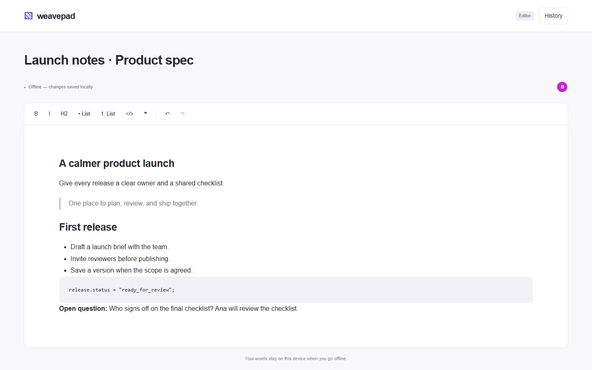
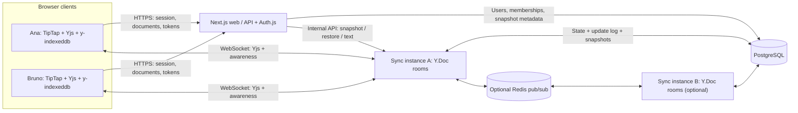

# Weavepad

A collaborative rich-text workspace with live cursors, offline editing, and shared version history.

[](https://github.com/GuilhermeBars/weavepad/actions/workflows/ci.yml)
[](LICENSE)



Built by **Guilherme Bars**. Weavepad is a portfolio project exploring the parts of collaborative editing that go beyond a text box: convergence, permissions, persistence, and recovery.

## Why it exists

A product brief should stay useful while two people revise it, someone loses their connection, or the team returns to an earlier draft. Weavepad keeps those workflows in one small workspace: shared documents, visible collaborators, local edits during a connection loss, and named versions to compare and restore.

## Features

- Rich text with headings, bold, italic, lists, quotes, code blocks, and collaborative undo/redo.
- Live editing across browser sessions, named remote carets, and a presence avatar stack.
- IndexedDB persistence for an open document, with edits merged on reconnect.
- Owner, editor, and viewer roles; sharing by email with users who have already signed in.
- Named snapshots, word-level text diffs against current server content, and shared restore.
- Personal and shared document lists; owners can rename and delete documents.
- Demo sign-in through Auth.js, with optional GitHub OAuth configuration.

| Collaboration                                                                                                                    | Sharing                                                                                           |
| -------------------------------------------------------------------------------------------------------------------------------- | ------------------------------------------------------------------------------------------------- |
| [](docs/screenshots/collaboration-side-by-side.png) | [](docs/screenshots/share-dialog.png) |
| **History**                                                                                                                      | **Offline editing**                                                                               |
| [](docs/screenshots/history-diff.png)                           | [](docs/screenshots/offline.png)         |

All screenshots come from the running production app. The side-by-side image composes two unmodified browser captures. [Dashboard](docs/screenshots/dashboard.png) · [Bruno's view](docs/screenshots/collaboration-bruno.png)

## Tech stack

| Layer            | Implementation                                                |
| ---------------- | ------------------------------------------------------------- |
| Web              | Next.js 15 App Router, React 19, TypeScript, Tailwind CSS 4   |
| Editor           | TipTap 3, Yjs, y-websocket, y-indexeddb                       |
| Identity         | Auth.js v5 beta, JWT sessions, demo Credentials provider      |
| Sync             | Node.js, ws, y-protocols, Zod, Pino                           |
| Storage          | PostgreSQL 16, Drizzle ORM, pg; PGlite for local development  |
| Optional fan-out | Redis 7 pub/sub through ioredis                               |
| Quality          | Vitest, Playwright/Chromium, ESLint, Prettier, GitHub Actions |

## Architecture



```mermaid
sequenceDiagram
  participant B as Browser
  participant W as Next.js / Auth.js
  participant P as Postgres
  participant S as Sync server
  B->>W: Demo sign-in (name + email)
  W->>P: Upsert user
  W-->>B: Session cookie
  B->>B: Load account-scoped IndexedDB Y.Doc
  B->>W: GET /api/docs/:id/token (session cookie)
  W->>P: Check document membership
  W-->>B: Five-minute HMAC token with role
  B->>S: WebSocket /:docId?token=...
  S->>S: Verify signature, expiry, room and role
  S->>P: Load base state + pending updates for new room
  B->>S: Yjs sync step 1 / state vector
  S-->>B: Missing state and server state vector
  B->>S: Missing local updates (editor / owner only)
  S-->>B: Awareness and ongoing remote updates
  S->>P: Batch append updates; compact periodically
  Note over B,S: At expiry, disconnect and fetch a fresh permission-checked token
```

See [the architecture guide](docs/architecture.md) for API contracts, persistence details, and failure semantics, and [deployment notes](docs/deployment.md) for Docker and CI.

## Design decisions and trade-offs

**Yjs CRDT instead of OT.** The editor needs to accept local operations while disconnected and merge them without replaying every keystroke through one central ordering service. Yjs and its TipTap integration provide that model. The trade-off is CRDT metadata and merge behavior that is deterministic rather than aware of the author's meaning.

**Concurrent edits converge, but do not resolve editorial intent.** Changes to different parts of a paragraph usually combine naturally. Two insertions at the same position are ordered by Yjs identifiers. Concurrent replacements of the same word can retain both inserted replacements; deletion of a parent node can hide edits inside it. All peers receiving the same updates converge, but the resulting sentence may still need human review. Offline edits use the same merge rules, not last-writer-wins replacement of the whole document.

**A custom y-websocket-compatible server.** Keeping the standard sync and awareness protocol allows the standard browser provider while putting token validation, persistence, room lifetime, role enforcement, and live snapshot/restore in one service. It also means maintaining protocol handling, backpressure, reconnection, and failure recovery ourselves.

**Viewer enforcement belongs on the server.** A disabled editor is only a convenience. The sync server discards viewer document updates, including both sync STEP2 and UPDATE frames, while allowing state reads and awareness. Web APIs independently check sessions, membership, roles, and mutation origins.

**Short-lived HMAC tokens instead of sharing session cookies.** The web app issues a document-scoped, five-minute signed token containing authenticated identity and role. The sync service needs the collaboration secret, not Auth.js session handling. Tokens are signed, not encrypted, and travel in the WebSocket query string; deployments must use TLS and avoid logging token-bearing URLs. Existing connections close at expiry. Revocation and role changes therefore have a bounded delay rather than immediate enforcement on an already open socket.

**An update log plus compaction.** Rooms batch updates into Postgres every second by default. After 100 updates, or on room unload, persisted state and pending updates are merged under a document-row lock. This bounds the replay log without overwriting another instance's persisted work. A process crash can lose an unflushed batch: the Connected badge confirms a sync handshake, not durable storage acknowledgment.

**Restore is a forward transaction.** The sync server clones snapshot content into a new transaction on the current Y.Doc. Applying old state directly would merge old operations, not rewind the document. Forward restore keeps peers on the same CRDT timeline. It replaces currently known content, but unseen offline edits can still merge later; edits inside deleted nodes may disappear and independently inserted blocks may survive. Named snapshots are explicit saves, not an automatic record of every revision.

**PGlite makes local development independent of Docker.** A Postgres wire-protocol bridge lets the same pg queries and migrations run against a local persistent database. It is a development substitute with different connection and failure behavior, not a production Postgres replacement. CI is configured to use PostgreSQL 16 for database-backed tests.

**Redis adds fan-out, not room sharding.** Instances subscribe per document and relay updates and awareness with instance-origin echo suppression. Peer state exchange helps recovery on subscription/reconnection. Redis pub/sub is not durable; outages can temporarily split live views. Each participating instance still holds the entire room and uses the shared database. This does not provide geographic routing, distributed ownership, or unlimited room capacity.

## Getting started

### Docker Compose

With Docker Engine and Compose installed, run from the repository root:

```sh
docker compose up --build
```

Open **http://localhost:3310**. Compose starts Postgres, Redis, migrations, sync, and web in dependency order. Sync is exposed on port **1234**; Postgres and Redis remain on the Compose network. Stop with Ctrl+C, then `docker compose down`. The database volume persists unless explicitly removed.

The default credentials and secrets are for local demos. Replace them for a deployment; use a URL-safe Postgres password. Demo authentication must be replaced or disabled before protecting private content. No port 3000 is required.

### Local, without Docker

Requires Node.js 20+ and npm. Copy `.env.example` to `.env` at the repository root and replace the three secret values with independent random values. For example, run `node -e "console.log(require('node:crypto').randomBytes(32).toString('hex'))"` for each secret.

```sh
npm install
npm run db:local
```

Keep that terminal open. In another terminal:

```sh
npm run db:migrate
npm run dev
```

Open **http://localhost:3310**. Local sync uses **1234**, and PGlite listens on **127.0.0.1:5432**, persisting in `.pglite/`. Stop both terminals with Ctrl+C. Web and sync load root `.env`; existing process environment values take precedence. Keep the shared `PORT` variable unset.

To try collaboration, sign in as Ana in one browser profile and Bruno in another. Both accounts must exist before Ana can invite Bruno by email. Create a document, select **Share**, add Bruno as an editor, and open the document URL in Bruno's session.

### Environment variables

The complete, commented template is [.env.example](.env.example).

| Variable                               | Purpose / default                                                                                                  |
| -------------------------------------- | ------------------------------------------------------------------------------------------------------------------ |
| `DATABASE_URL`                         | Required pg connection string; local example uses `127.0.0.1:5432/postgres`                                        |
| `AUTH_SECRET`                          | Required Auth.js session secret                                                                                    |
| `AUTH_URL`                             | Browser-facing origin; `http://localhost:3310` locally                                                             |
| `AUTH_TRUST_HOST`                      | Set `true` only for a trusted host/proxy; Compose sets it                                                          |
| `AUTH_GITHUB_ID`, `AUTH_GITHUB_SECRET` | Optional; both required to enable GitHub OAuth                                                                     |
| `COLLAB_TOKEN_SECRET`                  | Required HMAC secret shared by web and sync                                                                        |
| `INTERNAL_API_SECRET`                  | Required independent secret for web-to-sync internal requests                                                      |
| `SYNC_INTERNAL_URL`                    | Server-only sync origin; local `http://127.0.0.1:1234`                                                             |
| `NEXT_PUBLIC_SYNC_URL`                 | Browser WebSocket URL; local `ws://localhost:1234`; embedded at build time                                         |
| `REDIS_URL`                            | Optional; empty disables fan-out; Compose supplies Redis                                                           |
| `SYNC_HOST`, `SYNC_PORT`               | Sync bind address and port; template uses `127.0.0.1`, `1234`                                                      |
| `PORT`                                 | Standalone sync port override; leave unset for joint local development                                             |
| `FLUSH_INTERVAL_MS`                    | Update batch interval; `1000`                                                                                      |
| `COMPACT_AFTER_UPDATES`                | Compaction threshold; `100`                                                                                        |
| `ROOM_IDLE_MS`                         | Idle room unload delay; `1000`                                                                                     |
| `PING_INTERVAL_MS`                     | WebSocket liveness interval; `30000`                                                                               |
| `MAX_PAYLOAD_BYTES`                    | WebSocket payload limit; `1048576`                                                                                 |
| `LOG_LEVEL`                            | Sync logging level; `info`                                                                                         |
| `POSTGRES_PASSWORD`                    | Compose database password; development default only                                                                |
| `NODE_ENV`                             | Runtime mode; build/start use production                                                                           |
| `NEXT_TELEMETRY_DISABLED`              | Optional `1` to disable Next.js telemetry                                                                          |
| `NEXT_OUTPUT`                          | `standalone` for Docker build; leave unset for local `next start`                                                  |
| `PLAYWRIGHT_BROWSERS_PATH`             | `0` keeps browsers project-local; scripts set it                                                                   |
| `E2E_USE_PGLITE`                       | `1` forces an isolated in-memory test DB; otherwise harness uses a supplied `DATABASE_URL` or falls back to PGlite |
| `E2E_SKIP_BUILD`                       | `1` reuses a matching E2E build; leave unset for normal runs                                                       |
| `E2E_SHUTDOWN_FILE`                    | Internal Playwright-generated shutdown signal path; do not configure manually                                      |

Changing `NEXT_PUBLIC_SYNC_URL` requires rebuilding the web app. The E2E build targets sync port 1310, so rebuild with your deployment environment before deploying it.

## Testing

```sh
npm run build -w @weavepad/shared
npm test
npm run e2e:install -w @weavepad/web
npm run e2e
```

The normal E2E command builds and runs the production stack on web port **3310** and sync port **1310**. Stop local dev first. It refuses to reuse occupied ports and shuts down its services after the run. Without an exported `DATABASE_URL`, it creates a disposable in-memory PGlite database. If supplying `DATABASE_URL`, use a dedicated test database, never a production database; the harness applies migrations.

Validated locally on September 30, 2026: **102 Vitest tests passed across 8 files**
(including the conditional database integration test, using migrated isolated
PGlite), **4 Chromium E2E tests passed** after a fresh production build, and the
separate **1 screenshot walkthrough passed**. No retries were needed.

| Suite         | Coverage                                                                                                                                                               |
| ------------- | ---------------------------------------------------------------------------------------------------------------------------------------------------------------------- |
| Shared domain | Roles, HMAC signing/expiry/tampering, rich snapshot projection, diff, forward restore, concurrent/duplicate update delivery                                            |
| Sync server   | Real WebSocket clients, viewer protocol enforcement, token expiry, persistence retries/compaction, room cleanup, snapshots/restore, fan-out and Redis adapter behavior |
| Web           | Route/session/membership guards, mutation origin and body limits, token issuance, last-owner protection, connection state                                              |
| Chromium E2E  | Two-client sync and carets; viewer UI and raw protocol attacks; concurrent offline merge/reload; snapshot diff and restore                                             |

One database-backed Vitest test is conditional on `DATABASE_URL`; plain `npm test` without it skips that test. Test database configuration must be exported into the test process, not merely written in root `.env`, and migrations must be applied first. Redis adapter tests use a test double; they do not establish real Redis outage or load behavior. E2E uses one Chromium worker. CI additionally configures Postgres-backed quality/E2E jobs and a Compose build/start/health smoke job.

### Reproduce the screenshots

```sh
npm run e2e:install -w @weavepad/web
npm run docs:screenshots
```

This separate Playwright configuration reuses the E2E production server harness, forces isolated PGlite, logs in Ana and Bruno, pastes a rich product brief through the editor, shares it, and checks real sync, presence, diff, and offline/reconnect behavior before capture. It writes seven **1440 × 900 PNGs** to `docs/screenshots/` and deletes the demo document during cleanup. The capture test is excluded from normal E2E runs. Dates and randomly assigned avatar colors can vary between runs.

## Project structure

```text
apps/
  web/
    app/                 Pages and authenticated document APIs
    components/          Editor, dashboard, sharing, history
    hooks/               Provider lifecycle and awareness
    e2e/                 Four browser scenarios
      docs/              Separate screenshot walkthrough
    scripts/             Production E2E server harness
  sync-server/
    src/                 Protocol, rooms, persistence, Redis, tests
packages/
  shared/
    src/                 Roles, tokens, versioning, Drizzle schema
    drizzle/             Committed migrations
tools/                   PGlite server and finite DB/sync smoke tools
docs/                    Architecture, deployment, screenshots
.github/workflows/       Quality, E2E, Docker CI
docker-compose.yml       Local container stack
```

## Limitations

- Demo sign-in accepts a name and email without a password or verification. Knowing an email is enough to impersonate that account. Enabling GitHub does not remove demo login.
- The deployment topology assumes a single region; there is no multi-region consistency or failover design, nor room sharding through Redis.
- Offline support covers an already loaded editor and IndexedDB recovery when the app can load again. There is no service worker for cold-starting the entire app offline.
- Sharing requires an existing user; there are no emailed invitations, public share links, or fine-grained inline comments.
- Snapshot diffs are text-level, so formatting-only changes are not visualized. Diffs use live server text and omit unsent offline edits.
- Role changes can take up to the token lifetime to affect existing sockets. Local cached content is not remotely erased by revocation.
- Persistence is batched, presence is transient, and Redis pub/sub is not a durable event log. No throughput, capacity, or availability guarantees have been measured here.
- Local validation uses PGlite. Docker, real Redis, GitHub OAuth, and real Postgres require their respective environments; local test success does not certify those deployments.

## Roadmap

Potential next steps, not current features:

- Production identity and invitation flows, with demo login disabled by configuration.
- Inline comments and review threads anchored to document ranges.
- Better formatting-aware diffs and snapshot attribution in the history UI.
- Operational metrics, failure-injection tests with real Redis, and measured load limits.
- Immediate access revocation and an explicit browser-cache retention policy.

Contributions are welcome; see [CONTRIBUTING.md](CONTRIBUTING.md). Released under the [MIT license](LICENSE).
